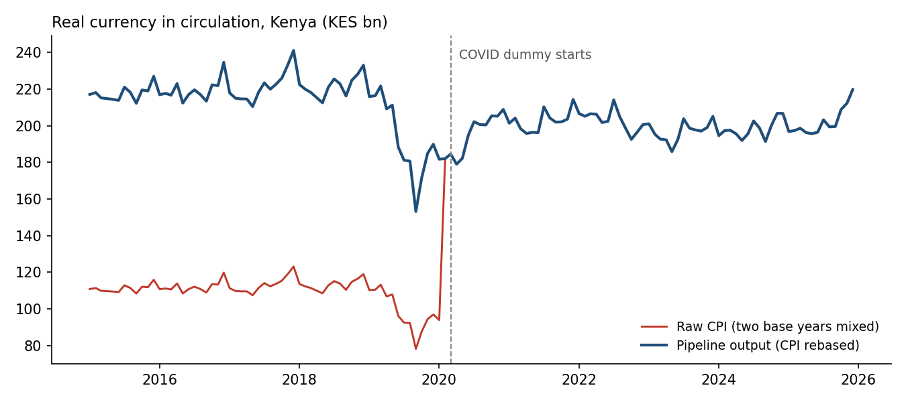

# Cashless Paradox: data pipeline

[](https://github.com/mohamedyasseruk2-arch/cashless-paradox-pipeline/actions/workflows/tests.yml)

The data pipeline behind my BSc dissertation, *The Cashless Paradox* (First-Class, University of Sussex, 2026).
The dissertation used ARDL bounds tests to ask whether COVID-19 broke the long-run link between
mobile-money use (M-Pesa) and demand for physical cash in Kenya.

This repository turns a hand-assembled raw spreadsheet of 132 monthly observations (Jan 2015 to Dec 2025)
into the analysis-ready dataset. **Its output reproduces all 48 summary statistics in the dissertation's
Table 3.0 exactly**, and a test checks that on every push.



*Why the cleaning matters: Kenya's CPI changed base year in 2020. Deflating with the raw series makes real
cash demand appear to double right at the start of COVID: a fake structural break in a study that is
testing for a structural break.*

## Data quality issues found and fixed

| Issue in the raw data | Fix | Guard |
|---|---|---|
| Numbers stored as text with units (`"2,366.6b"`, `"459,277ton"`) | `parse_number` strips separators and units | unit test |
| Oct–Dec 2025 M0 typed ~10x too large | Replaced with values checked against the CBK release | Pipeline **fails** if any *other* month is implausible |
| CPI switches from a Feb 2009 base to a Feb 2019 base in 2020 | Spliced with link factor 100 / 195.78 | `validate` rejects any month-on-month CPI jump > 5% |
| CPI missing for Jan 2020 (transition) and Dec 2025 (unreleased) | Linear interpolation / carried forward | no-NaN check |
| Policy rate typed as percentages (8.5) for Jan–Jul 2015, decimals after | Values > 1 divided by 100 | range check 0–0.3 |
| COVID dummy started in Feb 2020 | Starts March 2020 (first lockdown measures) | unit test |
| GDP is annual only, but the model is monthly | Proportional Denton disaggregation using cement consumption as the indicator; 2025 extrapolated at the 3-year trailing growth rate (flagged as an estimate) | each year must sum exactly to its CBK benchmark |

## Pipeline

```
data/raw/kenya_monthly_raw.xlsx
  → load_raw            parse dates ("2015m01"), select and rename columns
  → fix_m0              units, documented corrections, anomaly guard
  → fix_cement          units
  → rebase_cpi          splice base years, fill gaps
  → fix_rates_and_dummy percentage/decimal mix, COVID dummy
  → derive              real M0, Denton monthly GDP, Vm = M-Pesa / GDP, logs
  → validate            invariants (132 months, no NaNs, benchmarks, ranges, CPI continuity)
data/processed/cashless_paradox_analysis.csv
```

## Run it

```bash
pip install -r requirements.txt
python src/cashless/pipeline.py   # writes the processed CSV and prints the summary table
python -m pytest -v               # 17 tests
python make_chart.py              # regenerates the chart above
```

## Sources

Central Bank of Kenya (currency in circulation, M-Pesa transaction values, central bank rate,
annual GDP) and Kenya National Bureau of Statistics (CPI, inflation, cement consumption).
The econometric estimation (unit-root tests, UECM, ARDL bounds tests) is reported in the dissertation
and is not part of this repository.
